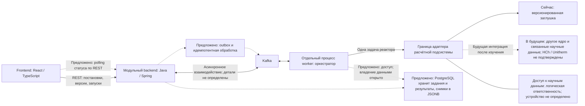

# Архитектура

## Статус и границы

Принята основа: один репозиторий, модульный прикладной backend и отдельный процесс worker. Frontend, backend, оркестрация, адаптер и доступ к научным данным имеют разные обязанности. Это не набор множества микросервисов и пока не реализованная система. Основания: `REQ-ARCH-001`–`REQ-ARCH-003` в [основе проекта](project-foundation.md) и [ADR-0001](adr/0001-monorepo-and-boundaries.md).

REST между браузером и backend и Kafka между backend и worker выбраны. Наполнение сообщений, надёжность доставки, таблицы и polling пока предложены. На схеме такие элементы помечены словом «Предложено»; она показывает обязанности и логические взаимодействия, не готовую сетевую конфигурацию.

Пунктирные связи помечены по смыслу: предложения либо будущие интеграции. Наличие PostgreSQL в стеке принято; конкретная роль хранилища на схеме предложена. Научные данные не приравниваются к этой PostgreSQL-схеме. Граница адаптера может охватить ядро вместе с его научной базой; она не обязывает делать отдельный сетевой сервис данных.

## Ответственность частей

| Часть | Ответственность | Ограничение |
| --- | --- | --- |
| Frontend | Рабочая копия, редакторы состава и условий, история и предметное сравнение, запуск и просмотр состояния, таблицы/графики, CSV и диагностика | Не подключается к Kafka; не является окончательной защитой прав или конфликтов |
| Прикладной backend | Аутентификация и серверные права, проекты/модели/версии, атомарная проверка текущей версии при сохранении, приём запусков для явной версии, выдача сохранённых данных | Не держит расчёт в открытом HTTP-запросе и не подменяет выбранную версию текущей |
| Worker с оркестратором | Выполнение заданий отдельно от HTTP, серии и зависимости реакторов, материальный перенос, фиксация результатов и диагностики | Не выдаёт зависимый шаг за успешный после ошибки предыдущего; детали хранения и доставки ещё проектируются |
| Адаптер | Преобразование зафиксированной задачи одного реактора в представление конкретной подсистемы и её ответа в представление приложения | Не задаёт неизвестный API HCh и не переносит оркестрацию цепочки внутрь решателя |
| Решатель | Одна равновесная задача; сейчас — возврат входного состояния заглушкой | Технический успех заглушки не подтверждает равновесие и не создаёт невычисленные свойства |
| Доступ к научным данным | Работа с выбранной версией библиотеки и потребностями ядра; общие и личные варианты, черновики/публикации на уровне приложения | Точная граница хранения и адаптера открыта; Unitherm не считается готовой PostgreSQL-схемой |

Это распределение обязанностей не закрепляет набор сборочных модулей, Java-пакетов, таблиц, endpoints или внутренние интерфейсы.

## Представления данных

`REQ-ARCH-002` различает три представления:

1. **Пользовательская постановка.** Модель, неизменяемые версии и отдельная рабочая копия. Предложенная полная граница снимка — `PROP-VER-002`.
2. **Зафиксированное задание.** Точные входы и версии для конкретного запуска; не следует за последующими изменениями текущей модели и значений по умолчанию.
3. **Представление конкретной подсистемы.** Формат ядра и связанные научные данные за адаптером. Он неизвестен для HCh/Unitherm и не должен заранее диктовать пользовательскую модель.

Схемы, единицы, правила нормализации и преобразований будут предметом изменения о домене и контрактах. На этапе документации типы и структуры этих представлений не выдумываются.

## Воспроизводимость и совместная работа

По `REQ-RUN-001` запуск сохраняет входы, версию модели, версию библиотеки, тип и версию решателя, значимые настройки, результат, диагностику и статус. Неизменяемая версия библиотеки и явная версия модели исключают незаметный переход на новые данные. Версионирование и фиксация постановки позволяют проверить происхождение; они не подтверждают научную корректность заглушки.

История модели имеет одну текущую версию и неизменяемых предшественников. Backend атомарно сравнивает ожидаемую текущую версию с фактической при сохранении. Интерфейс сообщает об устаревании и сохраняет введённые изменения для выбора действия. Варианты v1/v2 и выход в отдельную модель — `SCN-VER-001`. Реализация механизма хранения, условных запросов и транзакций пока не выбрана.

Проектные права проверяются сервером. Три проектные роли предложены в `PROP-ACCESS-001`. Библиотечные привилегии назначаются отдельно; владение исследовательским проектом само по себе их не предоставляет (`REQ-LIB-003`). Точная модель назначения и области действия ещё открыта. Сохранение прав и воспроизводимости учитывается с первого доменного контракта, хотя соответствующие пользовательские функции могут поставляться позже.

## Асинхронное выполнение

Приняты сохранённые задания и состояния: очередь, выполнение, успех, ошибка, отмена (`REQ-RUN-002`). Этот список не задаёт окончательную диаграмму переходов, политику повторов, отмены, частичных результатов и восстановления после сбоя.

Для технического дизайна предложены (`PROP-ASYNC-001`, `PROP-DATA-001`, `PROP-MSG-001`):

- PostgreSQL как источник состояния заданий и результатов; обычные таблицы для метаданных и JSONB для снимков и части результатов;
- Kafka-сообщения преимущественно с идентификаторами и метаданными;
- transactional outbox и идемпотентная обработка;
- polling состояния по REST.

Эти предложения описаны в [ADR-0006](adr/0006-proposed-persistence-and-delivery.md). Не согласованы топики, схемы сообщений, владение таблицами, транзакционные границы, повторы и дедупликация. Сам факт выбора Kafka не даёт гарантий единственного выполнения задачи.

## Научная граница и демонстрация

Заглушка возвращает входное состояние одной задачи, явный тип и версию, технический статус и диагностику без заявления о равновесии (`REQ-SCI-001`–`REQ-SCI-004`, [ADR-0002](adr/0002-demonstration-solver.md)). Входные фазовые данные для демонстрации переноса задаются заранее; UI и CSV сохраняют маркировку демонстрации.

Оркестратор формирует задачи серии и управляет переносом. Предложенные независимая серия и линейная цепочка с одним проходом описаны в [ADR-0007](adr/0007-proposed-series-and-transfer.md). Согласованы материальный баланс, передача количеств с растворителем и запрет успешного зависимого результата после ошибки; детальная семантика ещё открыта.

Заменяемость всей подсистемы — принятая цель архитектурной границы ([ADR-0004](adr/0004-libraries-and-reproducibility.md)). Доступность HCh/Unitherm, их API и совместимость не подтверждены. Обоснованные внешними материалами сведения будут добавляться с источниками в отдельном исследовании.

## Среда и инструменты

Выбранный стек — `REQ-TECH-001`, [ADR-0005](adr/0005-selected-stack-and-async-boundary.md). Рекомендации — `PROP-TECH-001`, [ADR-0008](adr/0008-proposed-tooling-and-environment.md). Точные версии и опубликованные ограничения проверены в [технологической основе](technology-baseline.md); их выбор и технический дизайн ещё предложены к просмотру, совместная сборка не выполнялась.

План размещения для разработки: frontend/backend/worker на Windows 10, PostgreSQL/Kafka на Ubuntu VPS. WSL2 не обязателен. Защищённый доступ обязателен, SSH/VPN и настройки Kafka не выбраны; публичное открытие БД/Kafka недопустимо. Локальные проверки и интеграционные проверки с доступным Docker Engine разделяются. На текущем этапе инфраструктура не устанавливается и соединения с VPS не выполняются.

Инициализирован OpenSpec; [первое изменение](../openspec/changes/application-scaffold/proposal.md) предлагает только технический каркас. Описанная выше архитектура продукта остаётся целевым направлением: в каркасе ещё не будет заданий, научного адаптера, persistence/Kafka-интеграций или проверки их готовности. Развёртывание VPS исключено из первого изменения.
