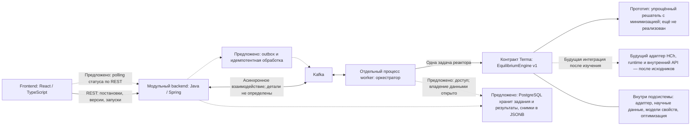

# Архитектура

## Статус и границы

Принята основа: один репозиторий, модульный прикладной backend и отдельный процесс worker. Технический каркас этих приложений уже реализован, собран и проверен ([отчёт](verification.md)); описанные ниже предметные обязанности остаются целевой архитектурой. Основания: `REQ-ARCH-001`–`REQ-ARCH-003` в [основе проекта](project-foundation.md), [ADR-0001](adr/0001-monorepo-and-boundaries.md) и [ADR-0011](adr/0011-equilibrium-contract-and-hch-adapter.md).

REST между браузером и backend и Kafka между backend и worker выбраны. Наполнение сообщений, надёжность доставки, таблицы и polling пока предложены. На схеме такие элементы помечены словом «Предложено»; она показывает обязанности и логические взаимодействия, не готовую сетевую конфигурацию.

Пунктирные связи помечены по смыслу: предложения либо будущие интеграции. Наличие PostgreSQL в стеке принято; конкретная роль хранилища на схеме предложена. Научные данные не приравниваются к этой PostgreSQL-схеме. Граница адаптера может охватить ядро вместе с его научной базой; она не обязывает делать отдельный сетевой сервис данных.

## Ответственность частей

| Часть | Ответственность | Ограничение |
| --- | --- | --- |
| Frontend | Рабочая копия, редакторы состава и условий, история и предметное сравнение, запуск и просмотр состояния, таблицы/графики, CSV и диагностика | Не подключается к Kafka; не является окончательной защитой прав или конфликтов |
| Прикладной backend | Аутентификация и серверные права, проекты/модели/версии, атомарная проверка текущей версии при сохранении, приём запусков для явной версии, выдача сохранённых данных | Не держит расчёт в открытом HTTP-запросе и не подменяет выбранную версию текущей |
| Worker с оркестратором | Выполнение заданий отдельно от HTTP, серии и зависимости реакторов, материальный перенос, фиксация результатов и диагностики | Не выдаёт зависимый шаг за успешный после ошибки предыдущего; детали хранения и доставки ещё проектируются |
| Расчётная подсистема | Проверка поддерживаемости, разрешение научных ссылок/данных, подготовка одной задачи ядра, вычисление, нормализация выхода/диагностики через EquilibriumEngine | Не получает граф проекта или правила цепочки; интерфейс приложения отличается от внутреннего API HCh |
| Адаптер конкретного ядра | Преобразование идентификаторов, единиц, внутренних структур и доступной диагностики; проверка совместимости системы/данных/моделей | Внутренние индексы, файлы, COM и runtime не просачиваются в оркестратор/UI; интеграция не реализована |
| Решатель | Одна задача реактора; в прототипе — реальная минимизация в согласованной упрощённой модели, отдельный результат и диагностика | Возврат входа без расчёта недостаточен; сходимость модели не подтверждает равновесие реальной системы, невычисленные свойства отсутствуют |
| Доступ к научным данным | Внутренняя часть подсистемы, при необходимости объединённая с адаптером; работа с chemicalSystemRef и thermodynamicDataRef | Области доступа, черновики/публикации и история принадлежат приложению; логические ссылки не требуют двух хранилищ; Unitherm не считается PostgreSQL-схемой |

Это распределение обязанностей не закрепляет набор сборочных модулей, Java-пакетов, таблиц, endpoints или внутренние интерфейсы.

## Представления данных

`REQ-ARCH-002` различает три представления:

1. **Пользовательская постановка.** Модель, неизменяемые версии и отдельная рабочая копия. Предложенная полная граница снимка — `PROP-VER-002`.
2. **Зафиксированное задание.** Точные входы и версии для конкретного запуска; не следует за последующими изменениями текущей модели и значений по умолчанию.
3. **Представление конкретной подсистемы.** Формат ядра и связанные научные данные за адаптером. Он неизвестен для HCh/Unitherm и не должен заранее диктовать пользовательскую модель.

Внешний расчётный контракт, единицы, схемы и семантические проверки теперь закреплены в [solver-contract.md](solver-contract.md) и [отдельном изменении OpenSpec](../openspec/changes/equilibrium-engine-contract/proposal.md). Граница полного снимка пользовательской модели и правила хранения ещё проектируются; внутренние типы HCh не выдумываются.

Вход задачи и результат различаются (`REQ-SCI-009`): CLOSED-запрос задаёт T/P и элементные количества, выход содержит присутствующие экземпляры фаз и вещества с отдельной диагностикой. Научные версии логически разделены на химическую систему и термодинамические данные; конкретное ядро разрешает их за адаптером. Это контракт Terma, не Java DTO или схема HCh. Детальная диаграмма границы и правила переноса приведены в едином источнике контракта.

## Воспроизводимость и совместная работа

По `REQ-RUN-001` запуск сохраняет входы, версию модели, версию библиотеки, тип и версию решателя, значимые настройки, результат, диагностику и статус. Неизменяемая версия библиотеки и явная версия модели исключают незаметный переход на новые данные. Для минимизации фиксируются также значимые численные настройки в составе условий запуска. Версионирование и фиксация постановки позволяют проверить происхождение; они не подтверждают научную достоверность упрощённой модели.

История модели имеет одну текущую версию и неизменяемых предшественников. Backend атомарно сравнивает ожидаемую текущую версию с фактической при сохранении. Интерфейс сообщает об устаревании и сохраняет введённые изменения для выбора действия. Варианты v1/v2 и выход в отдельную модель — `SCN-VER-001`. Реализация механизма хранения, условных запросов и транзакций пока не выбрана.

Проектные права проверяются сервером. Три проектные роли предложены в `PROP-ACCESS-001`. Библиотечные привилегии назначаются отдельно; владение исследовательским проектом само по себе их не предоставляет (`REQ-LIB-003`). Точная модель назначения и области действия ещё открыта. Сохранение прав и воспроизводимости учитывается с первого доменного контракта, хотя соответствующие пользовательские функции могут поставляться позже.

## Асинхронное выполнение

Приняты сохранённые задания и состояния: очередь, выполнение, успех, ошибка, отмена (`REQ-RUN-002`). Этот список не задаёт окончательную диаграмму переходов, политику повторов, отмены, частичных результатов и восстановления после сбоя.

Для технического дизайна предложены (`PROP-ASYNC-001`, `PROP-DATA-001`, `PROP-MSG-001`):

- PostgreSQL как источник состояния заданий и результатов; обычные таблицы для метаданных и JSONB для снимков и части результатов;
- Kafka-сообщения преимущественно с идентификаторами и метаданными;
- transactional outbox и идемпотентная обработка;
- polling состояния по REST.

Эти предложения описаны в [ADR-0006](adr/0006-proposed-persistence-and-delivery.md). Не согласованы топики, схемы сообщений, владение таблицами, транзакционные границы, повторы и дедупликация. Сам факт выбора Kafka не даёт гарантий единственного выполнения задачи.

## Научная граница и демонстрация

Прототип должен действительно выполнять минимизацию для одной задачи реактора и формировать отдельный вычисленный выход (`REQ-SCI-008`–`REQ-SCI-012`, [ADR-0010](adr/0010-prototype-minimization-solver.md)). [ADR-0002](adr/0002-demonstration-solver.md) о возврате входного состояния заменён 25 октября 2026 года. Целевая функция, метод, допустимые вещества/фазы, научные данные и численные критерии пока не выбраны; до реализации они согласуются с научным экспертом (`Q-SCI-004`–`Q-SCI-006`).

UI и CSV показывают тип/версию и ограничения упрощённой модели, различают входные и выходные величины. Сходимость, техническое выполнение и научная достоверность не приравниваются друг к другу. Ошибка или несходимость не маскируются копированием входа; невычисленные свойства отсутствуют (`REQ-SCI-003`, `REQ-SCI-010`, `REQ-SCI-011`). Для переноса используются рассчитанные выходные количества поддерживаемых веществ по фазам; начальное распределение само по себе не заменяет расчёт.

Оркестратор формирует задачи серии и управляет переносом. Предложенные независимая серия и линейная цепочка с одним проходом описаны в [ADR-0007](adr/0007-proposed-series-and-transfer.md). Согласованы материальный баланс, передача количеств с растворителем и запрет успешного зависимого результата после ошибки; детальная семантика ещё открыта.

Заменяемость всей подсистемы принята в [ADR-0004](adr/0004-libraries-and-reproducibility.md) и уточнена [ADR-0011](adr/0011-equilibrium-contract-and-hch-adapter.md): после получения исходников временное ядро заменяется HCh. Алгоритм, runtime, доступ к данным и внутренний API могут измениться. Неизменность контракта — цель, не гарантия; изменение major сохраняет чтение старых результатов. Публичные факты и неизвестное отделены в [исследовании](research/hch-public-evidence.md).

## Среда и инструменты

Выбранный стек — `REQ-TECH-001`, [ADR-0005](adr/0005-selected-stack-and-async-boundary.md). Поднабор каркаса принят в ADR-0009, его версии закреплены в [технологической основе](technology-baseline.md) и сборочных файлах; совместные сборки и локальные/CI-проверки выполнены ([отчёт](verification.md)). Остальные рекомендации `PROP-TECH-001` и [ADR-0008](adr/0008-proposed-tooling-and-environment.md) не приняты автоматически.

План размещения для разработки: frontend/backend/worker на Windows 10, PostgreSQL/Kafka на Ubuntu VPS. WSL2 не обязателен. Защищённый доступ обязателен, SSH/VPN и настройки Kafka не выбраны; публичное открытие БД/Kafka недопустимо. Локальные проверки и интеграционные проверки с доступным Docker Engine разделяются. На текущем этапе инфраструктура не устанавливается и соединения с VPS не выполняются.

Инициализирован OpenSpec; [первое изменение](../openspec/changes/application-scaffold/proposal.md) реализует только технический каркас по согласованному [ADR-0009](adr/0009-application-scaffold.md). Описанная выше архитектура продукта остаётся целевым направлением: в каркасе нет заданий, научного адаптера, persistence/Kafka-интеграций или проверки их готовности. Развёртывание VPS исключено; состояние проверок — в [отчёте](verification.md).
