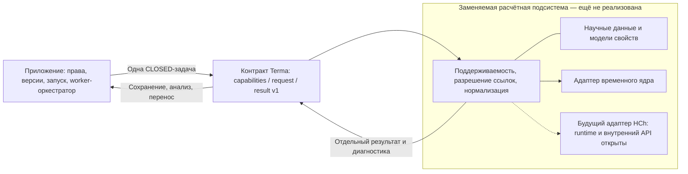

# Контракт расчётной подсистемы Terma v1

Статус: **согласованное пользователем архитектурное решение, оформленное для ревью документационного PR**. Решатель, адаптер HCh и runtime-валидация сейчас не реализуются. [ADR-0011](adr/0011-equilibrium-contract-and-hch-adapter.md) фиксирует основания; [delta spec](../openspec/changes/equilibrium-engine-contract/specs/equilibrium-engine-contract/spec.md) задаёт проверяемое будущее поведение с трассировкой `REQ-CONTRACT-*`. Этот документ — единый подробный источник семантики. JSON Schema определяют структуру и не заменяют семантические проверки.

## 1. Граница приложения и подсистемы

| Владелец | Обязанности |
| --- | --- |
| Приложение | Проекты, серверные права, версии моделей и история; неизменяемая фиксация постановки запуска; серии T/P и перенос вещества; сохранение результатов, таблицы, графики и будущий CSV |
| Расчётная подсистема | Проверка поддерживаемости; разрешение научных идентификаторов/данных; подготовка задачи ядра; вычисление одного реактора; нормализация результата и диагностики |
| Внутри подсистемы | Адаптер конкретного ядра, научные данные и модели свойств, внутренние структуры оптимизации |

Логический интерфейс приложения:

```text
EquilibriumEngine.describeCapabilities() → capabilities
EquilibriumEngine.calculate(request) → result
```

Это наш контракт, не имена методов HCh и не HTTP API. Отдельный сервис не требуется. Нативное ядро может впоследствии исполняться в другом процессе/runtime за адаптером; выбор зависит от исходников. Оркестратор в worker передаёт одну задачу реактора, не граф проекта и не правила всей цепочки. Нормализация пользовательских веществ/масс/концентраций до элементных количеств выполняется вне численного ядра по данным выбранной версии системы. Разрешение ссылок и окончательная проверка поддерживаемости принадлежат подсистеме.



## 2. Версии научных ссылок

Обе ссылки состоят из непустых `id` и `versionId` и разрешаются только в **неизменяемую** версию:

- `chemicalSystemRef` определяет допустимые вещества, определения фаз, принадлежность веществ фазам и выбранные модели фаз.
- `thermodynamicDataRef` определяет набор термодинамических данных с происхождением и соглашениями, нужными реализации.

Это логическое разделение, без требования двух серверов, БД или независимых файлов. Если ядро допускает только связанные сочетания системы, данных и моделей, адаптер проверяет именно сочетание. Известное, но несовместимое сочетание даёт `UNSUPPORTED`; неизвестный идентификатор/версия — `INVALID_INPUT`, временная недоступность хранилища — инфраструктурная ошибка приложения, не доказательство отсутствия версии.

Идентификаторы приложения не являются индексами, именами файлов или внутренними кодами HCh. Отображение локализовано в адаптере. Для химической системы [схема](../contracts/equilibrium/v1/chemical-system.schema.json) фиксирует идентичность элементов, стехиометрию и заряд веществ, определения фаз и ссылки на модели; внутренние формулы моделей и параметры оптимизатора в неё не входят. Формула служит подписью, а не ключом вещества. Связи/уникальность ID, принадлежность веществ, полнота состава и соответствие версии проверяются семантически. Физическая схема Unitherm этим не определяется.

## 3. CalculateEquilibriumRequest 1.0

[JSON Schema запроса](../contracts/equilibrium/v1/request.schema.json), [пример](../contracts/equilibrium/v1/examples/request.json).

| Поле | Семантика |
| --- | --- |
| `contractVersion` | Точная версия `1.0`; major/minor, не версия ядра |
| `calculationId` | Непустой идентификатор вызова для корреляции; не ключ проекта, не гарантия идемпотентности, не весь запуск серии |
| `conditions.temperatureK` | Конечная положительная температура, K |
| `conditions.pressurePa` | Конечное положительное абсолютное давление, Pa |
| `system.mode` | Для первой реализации только `CLOSED` |
| `system.elementAmountsMol` | Объект «идентификатор элемента → неотрицательное количество, моли атомов»; хотя бы одно количество положительно |
| `chemicalSystemRef`, `thermodynamicDataRef` | Выбранные неизменяемые версии |
| `requirements` | Список `{code, scope}` явно требуемых свойств; scope = SYSTEM / PHASE / SPECIES; при отсутствии нормализуется в `[]` |
| `solverOptions` | Объект общих опций; допускается `{}`; эффективные значения фиксируются в provenance |

Разрешённые общие опции v1: `maxIterations` — положительное целое; `balanceAbsoluteToleranceMol` — положительный абсолютный допуск в молях атомов; `balanceRelativeTolerance` — неотрицательный безразмерный допуск. Это словарь контракта, не обещание поддержки каждой опции любым ядром. Capabilities объявляют допустимое подмножество. Неподдерживаемая явно переданная опция отвергается, а не игнорируется. Если опция не передана, используется документированный default реализации с записью эффективных значений; defaults численного метода этим документом не выбираются. Проверка баланса обязательна независимо от поддержки лимита итераций.

### Проверки входа

1. В v1 задаются T/P и **нейтральный валовой элементный состав закрытой системы**. Электрон, заряд, открытые компоненты и фиксированные потенциалы не являются дополнительными элементами или скрытыми опциями. Заряженные вещества внутри допустимой модели возможны; итоговая нейтральность проверяется подсистемой по их зарядам, без изобретения общего допуска заряда в этом контракте.
2. Неуказанные известные элементы имеют нулевое количество. Неизвестные идентификаторы, в том числе с нулевым количеством, не игнорируются. Отрицательные количества, NaN, Infinity, неположительные T/P и полностью пустая материальная система отклоняются. JSON с нестандартными числами и переполнением чисел не допускается.
3. Список исходно загруженных веществ пользовательской постановки не ограничивает вещества, которые могут образоваться. Допустимый набор берётся из `chemicalSystemRef`.
4. Начальное приближение отличается от материального состава; в контракте 1.0 такого обязательного поля нет. Кандидат численного ядра может строить внутреннее приближение самостоятельно.
5. Неизвестные обязательные режимы, свойства, версии и опции не пропускаются молча. Известный режим или свойство вне возможностей выбранной реализации дают `UNSUPPORTED`. Прочие неизвестные поля запроса не проходят строгую схему 1.0; их нельзя использовать для скрытого выбора HCh или другого ядра.
6. Поля LP, матрицы, H/S/V, имена методов COM и настройки конкретного HCh в запрос приложения не входят. Требуемые данные не передаются неверсированным набором параметров в `solverOptions`.

Нечитаемый JSON или запрос без распознаваемой версии/корреляционного конверта отклоняется на границе вызова до `calculate`; адаптер не выдумывает `calculationId`, версии или численные условия. Это не новый HTTP endpoint. Для распознанного вызова предметно неверные поля дают `INVALID_INPUT`. В ошибочном результате `conditions` содержит извлечённые конечные численные условия, даже если они недопустимы, либо `null`, если условия извлечь нельзя. Использованные научные ссылки в provenance остаются `null`, если разрешение/применение не состоялось; диагностический путь указывает на вход. Это техническое представление ошибки, не успешный расчёт и не копирование входа в `solution`.

## 4. CalculateEquilibriumResult 1.0

[JSON Schema результата](../contracts/equilibrium/v1/result.schema.json), [успешный пример](../contracts/equilibrium/v1/examples/result-converged.json), [ошибка](../contracts/equilibrium/v1/examples/result-invalid-input.json).

Обязательны `contractVersion`, `calculationId`, `status`, `provenance`, `conditions`, `diagnostics`. `calculationId` совпадает с вызовом, `conditions` при успехе совпадают с входными T/P в SI без скрытого изменения. `solution` присутствует **только** для `CONVERGED`; при любом другом статусе поля нет, а не `null` или вход вместо результата.

### Provenance

| Поле | Значение |
| --- | --- |
| `adapter` | `id`/`version` адаптера или расчётной реализации Terma |
| `engine` | `id`/`version` выбранного ядра; при отказе до выбора может быть `null` |
| `modelKind` | `DEMONSTRATION` или `SCIENTIFIC_MODEL`; второе не обещает научной валидации |
| `chemicalSystemRef`, `thermodynamicDataRef` | Реально использованные версии; при успехе обязательные ненулевые ссылки |
| `appliedModels` | Список `id`/`versionId` реально применённых моделей; невыбранные кандидаты не перечисляются |
| `effectiveSolverOptions` | Эффективные значимые общие настройки, включая использованные допуски баланса; при отказе до применения может быть `{}` |

Выбор ядра сам по себе не утверждает, что оно было вызвано: это видно из статуса и диагностики. Успешный результат обязан иметь полностью разрешённое provenance. Внутренние параметры, влияющие на воспроизводимость, дополнительно сохраняются подсистемой как версионируемая конфигурация реализации/модели; их не нужно превращать в общий входной API.

### Solution и фазы

`solution.elementAmountsMol` — итоговые количества элементов. `solution.phases` — непустой массив присутствующих фаз. `solution.properties` необязателен. Для каждой фазы:

| Поле | Значение |
| --- | --- |
| `phaseInstanceId` | Уникальный идентификатор внутри результата; для переноса хранится вместе с идентификатором результата, не предполагает стабильности между запусками |
| `phaseDefinitionId` | Ссылка на определение фазы выбранной версии химической системы |
| `phaseType` | Расширяемая классификация, не ID фазы и не модель свойств |
| `species` | Непустой массив `speciesId` / `amountMol` и необязательных `properties` конкретного species; количества в молях соответствующих веществ |
| `elementAmountsMol` | Вычисленные количества элементов этой фазы, моли атомов |
| `properties` | Необязательные действительно вычисленные свойства |

Одна фаза может содержать несколько веществ. Чистая фаза — частный случай с одним веществом. Несколько разных фаз одного типа, в том числе экземпляров одного определения, допускаются, если это разрешает выбранная модель. Отсутствующие фазы не перечисляются; присутствующая фаза имеет положительное количество вещества. Нулевые species-строки не создают фиктивную присутствующую фазу. Стехиометрия и принадлежность веществ проверяются по выбранной системе, а не по строке химической формулы.

Предложенный и зафиксированный здесь словарь `phaseType`: `SOLID`, `LIQUID`, `AQUEOUS`, `GAS`, `FLUID`, `OTHER`. Это широкие категории, не отождествление фазы с агрегатным состоянием. Расширение допускается непустой строкой-кодом. Клиент сохраняет неизвестный код, показывает нейтральную подпись «неизвестный тип: код» и использует `phaseDefinitionId`/`phaseInstanceId`, не переклассифицируя его в известную фазу и не теряя количества. Возможности временного решателя не следуют из этого списка.

### Свойства

Свойство — типизированная числовая запись `{code, value, unit}`; `value` — конечное JSON number. Для безразмерной величины `unit` равна `1`, а не отсутствует. Невычисленное свойство опускается, не заменяется нулём. Место записи задаёт её объект: `solution.properties` — система, `phase.properties` — экземпляр фазы, `phase.species[i].properties` — вхождение species в этой фазе. В пределах одного объекта код свойства уникален.

Каждый requirement имеет ровно `{code, scope}`. Пара `(code, scope)` уникальна в запросе. Семантика обязательности:

- `SYSTEM` — свойство обязательно в `solution.properties`.
- `PHASE` — свойство обязательно у **каждой присутствующей фазы**.
- `SPECIES` — свойство обязательно у **каждого присутствующего вхождения species каждой фазы**. Один speciesId в двух фазах — два объекта; идентичность в результате задаётся парой `(phaseInstanceId, speciesId)`.

Например, `[{"code":"GIBBS_ENERGY","scope":"SYSTEM"}]` не требует энергий фаз. Для обоих уровней нужны две отдельные записи с SYSTEM и PHASE. Выбор конкретного subject в 1.0 не предусмотрен. Это намеренно строгая семантика: требование PHASE для PH не означает «только водные фазы»; если свойство неприменимо хотя бы к одному целевому объекту, обязательство не выполнено. Нет целевых объектов, свойства или подходящего `(code, scope)` в capabilities — `UNSUPPORTED`, без solution. Проверка обязательных свойств выполняется перед принятием CONVERGED; наличие значения только у первой фазы/species недостаточно. Пустой requirements не делает научные свойства обязательными.

| Стандартный код | Область | Единица | Смысл |
| --- | --- | --- | --- |
| `GIBBS_ENERGY` | SYSTEM / PHASE | J | Энергия всей системы или конкретной фазы |
| `PH` | PHASE | 1 | pH водной фазы с модельной интерпретацией |
| `VOLUME` | SYSTEM / PHASE | m3 | Объём системы или фазы |
| `ACTIVITY` | SPECIES | 1 | Активность данного species в данной фазе |
| `ACTIVITY_COEFFICIENT` | SPECIES | 1 | Коэффициент активности данного species в данной фазе |
| `CHEMICAL_POTENTIAL` | SPECIES | J/mol | Химический потенциал данного species в данной фазе |

Наличие кодов не обещает поддержки модели и не обязывает ядро возвращать эти величины. Нестандартный код имеет пространство имён, например `demo:objective`; его смысл, область SYSTEM/PHASE/SPECIES и единицы объявляются в capabilities и документации реализации. Количество итераций — необязательная диагностическая метрика, не обязательное научное свойство.

Для любой энергии, включая нестандартную, обязательна непустая `referenceConvention` с указанием соглашения отсчёта. Для `GIBBS_ENERGY` и `CHEMICAL_POTENTIAL` это проверяется схемой, для нестандартных кодов — по объявлению свойства и семантической проверке. Абсолютные значения разных наборов/ядер не считаются автоматически сопоставимыми. Одинаковый код и единица без совместимости моделей, данных и отсчёта недостаточны для сравнения.

## 5. Исход вызова и диагностика

| Статус | Значение |
| --- | --- |
| `CONVERGED` | Адаптер принял успешное решение заявленной модели после проверок; не доказательство точности для природного объекта |
| `INVALID_INPUT` | Недопустимые входные значения, неизвестные идентификаторы или версии |
| `UNSUPPORTED` | Не поддержаны постановка, сочетание системы/данных/моделей, явно требуемое свойство или опция |
| `INFEASIBLE` | Установлена несовместность ограничений в заявленной модели; нехватка данных или сбой вычисления не доказывают несовместность |
| `ITERATION_LIMIT` | Достигнут распознаваемый лимит без принятого решения |
| `NUMERICAL_FAILURE` | Численный сбой либо результат не прошёл обязательную проверку, например баланс |

Очередь, выполнение, отмена всего запуска, Kafka, ошибки хранения и аварийное завершение процесса принадлежат оркестратору. Они не добавляются в этот enum и не маскируются «научной» ошибкой. Повторный запуск — новый вызов и новый результат; политика доставки/идемпотентности отдельно не решается.

`diagnostics.messages` — массив записей `code`, `severity` (`INFO`/`WARNING`/`ERROR`), `text`, необязательный `path` (JSON Pointer в запросе). Коды стабильны для машинной обработки, текст понятен человеку. Неуспех имеет хотя бы одно сообщение ERROR. `diagnostics.metrics` необязателен: записи `code`/`value`/`unit` только для доступных численных показателей. `diagnostics.balance` присутствует при успехе и содержит `passed`, абсолютный/относительный допуски и максимальную абсолютную невязку; единица абсолютных величин указана полем `unit: mol`. Это проверка адаптера, даже если ядро не отдаёт собственную подробную диагностику. Флаги/метрики ядра не выдумываются. Детальный критерий оптимальности, энергия, pH, активности, объём и число итераций не являются обязательными полями всех ядер.

### Обязательная проверка материального баланса

Для каждого элемента из объединения входа, фаз и итогового состава пропуски считаются нулями. Пусть `b[e]` — вход, `t[e]` — итог, `p[e]` — сумма фаз, `s_phase[e]` — сумма стехиометрических вкладов веществ фазы. Адаптер проверяет:

```text
|t[e] - b[e]| <= a + r * |b[e]|
|p[e] - t[e]| <= a + r * |t[e]|
|s_phase[e] - phase.elementAmountsMol[e]| <= a + r * |phase.elementAmountsMol[e]|
```

`a` — эффективный `balanceAbsoluteToleranceMol`, `r` — `balanceRelativeTolerance`; проверки не обходятся опусканием исчезнувшего элемента. `maxAbsoluteResidualMol` — максимум абсолютных разностей из всех трёх групп, не самостоятельный критерий: каждый элемент проходит свой порог. Суммирование учитывает конечность значений; переполнение отклоняется. Успех также требует допустимых неотрицательных количеств, известных связей species/phase и нейтральности CLOSED-модели. Если результат не проходит проверку, `solution` не публикуется как успешный.

## 6. Capabilities

[JSON Schema](../contracts/equilibrium/v1/capabilities.schema.json), [синтетический пример](../contracts/equilibrium/v1/examples/capabilities.json). Обязательны `contractVersion`, `implementation` (adapter/engine/modelKind), `supportedContractVersions`, `supportedModes`, `supportedPhaseModels` (версии моделей), `availableProperties` (код, числовой тип, единица, область, требование соглашения отсчёта) и `supportedSolverOptions`. `limits` необязателен и содержит только известные пределы размера/условий. Первая временная реализация объявляет только реально реализованные возможности; пример не является ответом существующего движка.

Дескриптор свойства уникален по `(code, scope)`. Общие определения схемы связывают стандартный код с областью, единицей и `referenceConventionRequired`: у энергий true, у PH/VOLUME/ACTIVITY/ACTIVITY_COEFFICIENT false. Нельзя объявить GIBBS_ENERGY в kJ без отсчёта, PH в mol или ACTIVITY в SYSTEM. Противоречивые дубликаты не становятся альтернативными трактовками.

Дескриптор опции уникален по `name`. `maxIterations` имеет INTEGER/1 с положительными целыми границами/default; `balanceAbsoluteToleranceMol` — NUMBER/mol с положительными включительными границами/default; `balanceRelativeTolerance` — NUMBER/1 с неотрицательными границами/default. Для численных допусков допустима `exclusiveMinimum` ≥ 0 вместо `minimum`, обе сразу запрещены. При отсутствии границ всё равно действуют базовые ограничения общей опции. Minimum не превышает maximum; exclusiveMinimum строго меньше maximum; default удовлетворяет типу и объявленному диапазону. Типы, единицы и индивидуальные значения проверяются JSON Schema; уникальность ключей и отношения между min/max/default — семантическими проверками. Это метаданные трёх общих опций v1, не универсальный язык ограничений.

### Версия документа и выбор версии calculate

`contractVersion: "1.0"` обозначает формат **документа capabilities**. `supportedContractVersions` — независимый непустой список точных версий **расчётного request/result**, в формате `major.minor` из неотрицательных целых без ведущих нулей. Поэтому документ capabilities 1.0 может корректно перечислять `["1.0", "1.1"]`; это не делает его документом 1.1 и не означает автоматическую поддержку 1.1 любым клиентом.

В текущем логическом интерфейсе `describeCapabilities()` без аргументов возвращает базовый документ capabilities 1.0, даже если реализация поддерживает несколько версий calculate. Его режимы/свойства/модели/опции и ограничения — **общие консервативные гарантии для всех перечисленных расчётных версий**, а не объединение возможностей разных версий. Реализация не должна объявлять в этом общем наборе свойство, доступное только в одной из версий. Версионно-специфичные расширения не подразумеваются; при необходимости их описания потребуется явно согласованное развитие формата capabilities.

Клиент сначала проверяет известный формат capabilities, затем пересекает список с точными версиями request/result, которые действительно умеет формировать, проверять и читать. По умолчанию выбирается наибольшая пара чисел `(major, minor)` в пересечении (1.10 больше 1.9), либо явно закреплённая клиентом версия из того же пересечения. Выбранная версия записывается в request.contractVersion; ответ обязан иметь ту же версию. Пустое пересечение — явный отказ до расчёта. Неизвестная версия не считается совместимой только из-за одинакового major; скрытого понижения, повышения или fallback нет. Пример с 1.1 — проверка объявления версий, не реализация будущего контракта 1.1 в этом репозитории.

Допустимость T/P зависит также от выбранных данных и моделей. Если общие пределы известны, они лишь предварительный фильтр и не обещают единого прямоугольника применимости всех веществ. `calculate` дополнительно проверяет выбранное сочетание. Запрос возможностей HCh нельзя удовлетворить скрытым переходом к демонстрационной модели или её capabilities. Автоматического fallback нет.

## 7. Временная реализация и HCh

Требование реального упрощённого вычисления сохраняется по [ADR-0010](adr/0010-prototype-minimization-solver.md). **Кандидат**, обсуждавшийся в web: линейная минимизация для чистых фаз, модель постоянных H/S/V и Hipparchus. Это краткая фиксация предложения `PROP-SOLVER-001`, не выбор научной методики, версии библиотеки или зависимости. Внутренние коэффициенты и типы этого кандидата не входят в общий контракт.

Unitherm не обязателен для прототипа. Допустима маленькая неизменяемая JSON-библиотека синтетических параметров с явным происхождением `DEMONSTRATION`; в этом PR примеры описывают только структуру, не содержат работающей научной библиотеки или оптимизатора. После получения исходников временная реализация заменяется подсистемой HCh: могут измениться алгоритм, внутренние структуры, доступ к научным данным, runtime и внутренний API. Данные/модели свойств могут быть объединены с адаптером, если это требует ядро; обязательный callback, возвращающий только `g(T,P)`, не навязывается. Открытые свидетельства и пределы знаний — в [исследовании](research/hch-public-evidence.md).

## 8. Перенос между реакторами

Оркестратор выбирает конкретные `phaseInstanceId` сохранённого успешного результата и долю `f` в диапазоне `[0,1]`. Для первой версии это однородная доля выбранной фазы: количества всех её веществ и элементов масштабируются одной долей. Сумма отправленного и оставшегося сохраняет исходные количества с допусками баланса. Избирательное извлечение species внутри фазы — отдельная будущая возможность.

Из переданных элементных количеств и собственного состава следующего реактора формируется новый CLOSED-запрос. Фазовое распределение предыдущего результата не навязывается следующему: оно вычисляется заново при его T/P. Выбор долей, граф и политика зависимостей принадлежат приложению; решатель не получает их как `solverOptions`. Перенос и смешение здесь не реализуются. Пример проверки: для фазы с H=2, O=1 доля 0.25 даёт H=0.5, O=0.25, остаток H=1.5, O=0.75 — это арифметика контракта, не расчёт равновесия.

## 9. Совместимость и история

Цель — сохранять контракт Terma при замене ядра настолько, насколько допускает предметная семантика. Это не гарантия до изучения исходников. Внутренние коды, индексы, единицы и форматы преобразует адаптер; UI/оркестратор не должны зависеть от них.

- Точная версия схемы указывается в каждом документе; схемы v1 сейчас фиксируют `1.0`. Несовместимый major не обрабатывается как известный контракт.
- Совместимые добавления необязательных выходных данных допускаются в minor-версии с новой опубликованной схемой. Читатели известного major сохраняют исходный документ, допускают неизвестные необязательные выходные поля и коды `phaseType`; не интерпретируют неизвестный статус как успех. Строгий валидатор 1.0 проверяет именно 1.0, а не автоматически все будущие minor.
- Новые обязательные поля, изменение смысла, единиц, существующего кода или поведения требуют нового major. Входные опции и свойства всегда проходят явную проверку версии/capabilities; неизвестное требование нельзя молча игнорировать ради совместимости.
- Исторические результаты сохраняются вместе с версией контракта, provenance и ссылками; читаются соответствующим reader/схемой. Они не переписываются при смене ядра или данных. Фиксация постановки запуска и конечные результаты неизменяемы, а технический жизненный цикл запуска может развиваться отдельно.
- Повторный расчёт другим ядром создаёт новый результат с новым provenance. Сравнение возможно лишь с учётом данных, моделей, области применимости и соглашений отсчёта.
- Отсутствие ожидаемых возможностей/данных приводит к явному отказу, без скрытой подстановки решателя или версии библиотеки. Смена контракта оформляется решением/ADR и миграцией чтения, не правкой старых документов.

## 10. Схемы, примеры и пределы проверки

Используется [JSON Schema Draft 2020-12](https://json-schema.org/draft/2020-12/json-schema-validation). [Общие определения](../contracts/equilibrium/v1/common.schema.json) переиспользуются схемами request/result/capabilities/chemical-system; `$id` — локально регистрируемые URN, не endpoints. Схемы 1.0 строги к неизвестным полям; расширяемые коды фаз и namespaced properties предусмотрены явно. Все числа должны быть конечны; строгий JSON-парсер отвергает NaN/Infinity и переполнение при чтении.

Синтетические примеры, их назначение и пары для проверки перечислены в [README примеров](../contracts/equilibrium/v1/examples/README.md). Успешный пример означает только корректную форму и согласованную стехиометрию данных, подготовленных вручную; он не выдан вычислением и не подтверждает минимум. Многокомпонентная фаза и пример свойств species — демонстрация структуры, не объявление поддержки временным ядром. Сценарий [tools/check_solver_contract.py](../tools/check_solver_contract.py) сохранён в репозитории и выполняется CI на Windows/Linux с закреплёнными инструментами проверки. Он проверяет структуру, фикстуры, балансы, обязательные свойства и согласованность capabilities; научный решатель не запускается. Команды воспроизведения и фактические проверки — [отчёт контракта](solver-contract-verification.md).

JSON Schema не доказывает существование выбранной версии, уникальность ключей по всему документу, принадлежность species, нейтральность, баланс, применимость T/P, выполнение capabilities или достижение минимума. Эти проверки описаны выше и в delta spec; будущая runtime-реализация требует отдельного поручения и задач. Права, версии моделей/библиотек, воспроизводимость, оркестрация серий и обязательный будущий CSV сохраняются.
